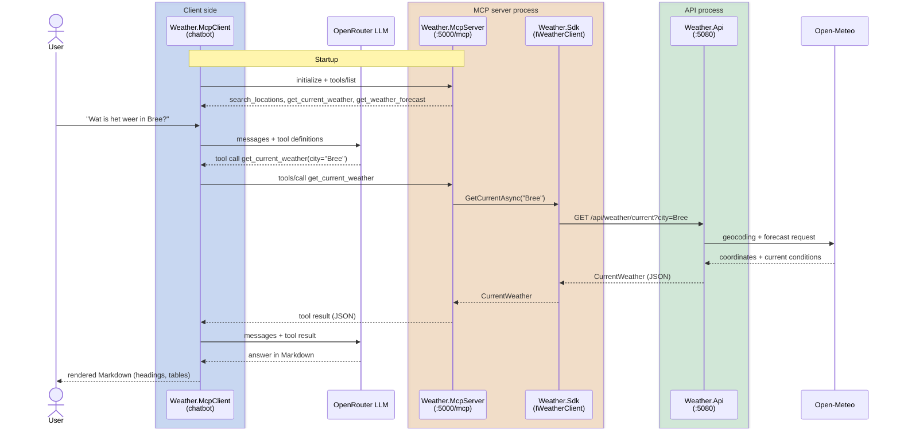

# Weather MCP monorepo

| Project | Purpose |
|---|---|
| `Weather.Models` | Shared contract types (`CurrentWeather`, `WeatherForecast`, `Location`, ...) |
| `Weather.Api` | ASP.NET minimal API; fetches data from Open-Meteo (no API key) |
| `Weather.Sdk` | `IWeatherClient` + typed HTTP implementation + `AddWeatherClient()` DI extension |
| `Weather.McpServer` | MCP server (streamable HTTP at `/mcp`, official `ModelContextProtocol` C# SDK); tools call the API **only through `IWeatherClient`** |
| `Weather.McpClient` | Console chatbot: an LLM via OpenRouter + the weather MCP tools. Needs `OPENROUTER_API_KEY`; `WEATHER_MCP_URL` (default `http://localhost:5000/mcp`), `OPENROUTER_MODEL` optional |

## Flow



## Run

Start order matters: **API -> MCP server -> client**. Ports: API `5080`, MCP server `5000`.

### Everything at once

```powershell
$env:OPENROUTER_API_KEY = "sk-or-v1-..."
./src/run-all.ps1               # API + MCP server + chatbot; Ctrl+C / `exit` stops all
./src/run-all.ps1 -NoClient     # only API + MCP server (no key needed)
```

Options: `-ApiPort 5080`, `-McpPort 5000`.

### One by one (separate terminals)

```powershell
dotnet run --no-launch-profile --project src/Weather.Api --urls http://localhost:5080
$env:WEATHER_API_URL = "http://localhost:5080"
dotnet run --no-launch-profile --project src/Weather.McpServer --urls http://localhost:5000
$env:OPENROUTER_API_KEY = "sk-or-v1-..."
dotnet run --project src/Weather.McpClient
```

Build only: `dotnet build Weather.slnx`. Stop running instances first, otherwise the build fails on locked DLLs.

MCP client config (e.g. Claude Desktop / Claude Code):

```json
{
  "mcpServers": {
    "weather": {
      "command": "dotnet",
      "args": ["run", "--project", "C:\\Users\\LucPeeters\\source\\repos\\weather-mcp\\src\\Weather.McpServer", "--no-launch-profile"],
      "env": { "WEATHER_API_URL": "http://localhost:5080" }
    }
  }
}
```

Tools: `search_locations`, `get_current_weather`, `get_weather_forecast`.
API: `GET /api/locations?query=`, `/api/weather/current?city=`, `/api/weather/forecast?city=&days=`.
