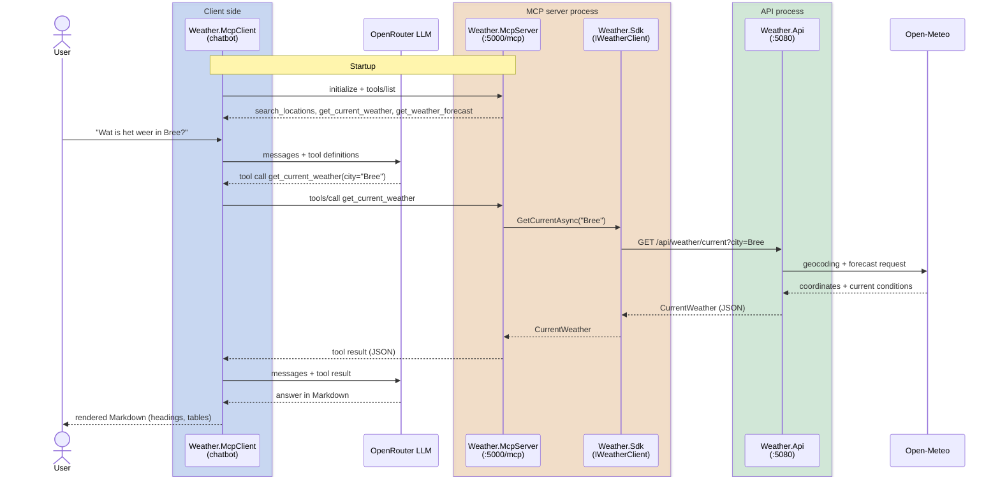

# Weather MCP monorepo

A weather MCP server for fetching local weather data via the Model Context Protocol, with a small weather API behind it and a console chatbot that uses the MCP tools. Weather data comes from Open-Meteo (no API key needed). Only the chatbot needs a key: an [OpenRouter](https://openrouter.ai) API key in `OPENROUTER_API_KEY`.

| Project | Purpose |
|---|---|
| `Weather.Models` | Shared contract types (`CurrentWeather`, `WeatherForecast`, `Location`, ...) |
| `Weather.Api` | ASP.NET minimal API; fetches data from Open-Meteo (no API key) |
| `Weather.Sdk` | `IWeatherClient` + typed HTTP implementation + `AddWeatherClient()` DI extension |
| `Weather.McpServer` | MCP server (streamable HTTP at `/mcp`, official `ModelContextProtocol` C# SDK); tools call the API **only through `IWeatherClient`** |
| `Weather.McpClient` | Console chatbot: an LLM via OpenRouter + the weather MCP tools. Needs `OPENROUTER_API_KEY`; `WEATHER_MCP_URL` (default `http://localhost:5000/mcp`), `OPENROUTER_MODEL` optional |

## Flow



## Run

Start order matters: **API -> MCP server -> client**. Ports: API `5080`, MCP server `5000`.

### Everything at once

```powershell
$env:OPENROUTER_API_KEY = "sk-or-v1-..."
./src/run-all.ps1               # API + MCP server + chatbot; Ctrl+C / `exit` stops all
./src/run-all.ps1 -NoClient     # only API + MCP server (no key needed)
```

Options: `-ApiPort 5080`, `-McpPort 5000`.

### One by one (separate terminals)

```powershell
dotnet run --no-launch-profile --project src/Weather.Api --urls http://localhost:5080
$env:WEATHER_API_URL = "http://localhost:5080"
dotnet run --no-launch-profile --project src/Weather.McpServer --urls http://localhost:5000
$env:OPENROUTER_API_KEY = "sk-or-v1-..."
dotnet run --project src/Weather.McpClient
```

Build only: `dotnet build Weather.slnx`. Stop running instances first, otherwise the build fails on locked DLLs.

## Deploy to Azure (azd)

Deploys `Weather.Api` (internal ingress) and `Weather.McpServer` (public ingress) to Azure Container Apps, with a container registry, Log Analytics and a managed identity for image pulls. Requires the [Azure Developer CLI](https://aka.ms/azd) and Docker is **not** needed (images are built with `dotnet publish`).

```bash
azd auth login
azd up                      # provision infra + build + deploy; asks for env name, subscription, region
azd env get-values          # shows MCP_URL (https://<fqdn>/mcp) and API_URL
azd deploy                  # redeploy code only
azd down                    # delete everything
```

The MCP server reaches the API through `WEATHER_API_URL`, set by the Bicep template. Point an MCP client at `MCP_URL` (see **Entra ID protection** below; the deployed endpoint requires a token).

## Entra ID protection

The MCP server validates Entra ID access tokens (JWT bearer) and serves OAuth protected-resource metadata (RFC 9728) at `/.well-known/oauth-protected-resource/mcp`. A token is accepted when its audience is the API app and it carries the delegated scope `Weather.Read` (signed-in users, `scp`) or the app role `Weather.ReadAll` (apps, `roles`).

```powershell
az login
./scripts/setup-entra.ps1 [-CreateClientSecret]   # creates weather-mcp-api + weather-mcp-client, stores IDs in the azd env
azd up                                            # deploys with AzureAd__TenantId / AzureAd__ClientId
```

The server fails to start without `AzureAd__TenantId` and `AzureAd__ClientId`. `Auth__Disabled=true` turns protection off for local development (`src/run-all.ps1` sets it).

The chatbot defaults to the deployed server and its Entra IDs, so against Azure just run `dotnet run --project src/Weather.McpClient` (browser sign-in; the OpenRouter key is downloaded from the server). When `WEATHER_MCP_URL` points at localhost, Entra is off by default. Override with these variables (the `ENTRA_*` values are printed by the script):

```powershell
$env:WEATHER_MCP_URL = '<MCP_URL>'
$env:ENTRA_TENANT_ID = '...'; $env:ENTRA_API_CLIENT_ID = '...'; $env:ENTRA_CLIENT_ID = '...'
# optional: $env:ENTRA_CLIENT_SECRET = '...'   -> app-only; otherwise interactive browser sign-in
dotnet run --project src/Weather.McpClient
```

## OpenRouter key in Key Vault

`azd up` also creates a Key Vault (RBAC, soft delete + purge protection). Only the MCP server's dedicated managed identity (`id-mcp-*`, role *Key Vault Secrets User*) can read it; the chatbot never touches the vault. The deployer (`AZURE_PRINCIPAL_ID`) gets *Key Vault Secrets Officer* so you can store the secret - remove that role assignment afterwards if you want the server to be the only reader.

Add the key yourself (it is never in source control):

```powershell
az keyvault secret set --vault-name (azd env get-value KEYVAULT_NAME) --name OPENROUTER-API-KEY --value '<your OpenRouter key>'
```

The MCP server serves it at `GET /secrets/openrouter-key` to callers with a valid Entra `Weather.Read` token. When `OPENROUTER_API_KEY` is not set but the `ENTRA_*` variables are, `Weather.McpClient` signs in and downloads the key from there, so against the deployed server you only need the `ENTRA_*` values and `WEATHER_MCP_URL`.
Claude Code / Desktop: Entra ID has no dynamic client registration, so their built-in OAuth flow can't sign in. Pass a token instead, e.g. in `.mcp.json`:

```json
{ "mcpServers": { "weather": { "type": "http", "url": "<MCP_URL>",
    "headers": { "Authorization": "Bearer ${WEATHER_MCP_TOKEN}" } } } }
```

with `$env:WEATHER_MCP_TOKEN = az account get-access-token --scope api://<ENTRA_API_CLIENT_ID>/Weather.Read --query accessToken -o tsv` (tokens last about an hour).

Files: `azure.yaml` (services), `infra/main.bicep` (resource group), `infra/resources.bicep` (resources).

MCP client config (e.g. Claude Desktop / Claude Code):

```json
{
  "mcpServers": {
    "weather": {
      "command": "dotnet",
      "args": ["run", "--project", "C:\\Users\\LucPeeters\\source\\repos\\weather-mcp\\src\\Weather.McpServer", "--no-launch-profile"],
      "env": { "WEATHER_API_URL": "http://localhost:5080" }
    }
  }
}
```

Tools: `search_locations`, `get_current_weather`, `get_weather_forecast`.
API: `GET /api/locations?query=`, `/api/weather/current?city=`, `/api/weather/forecast?city=&days=`.
